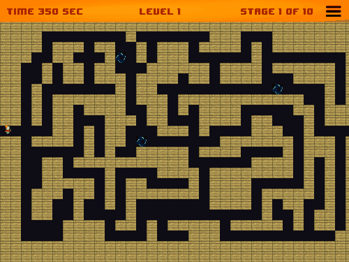
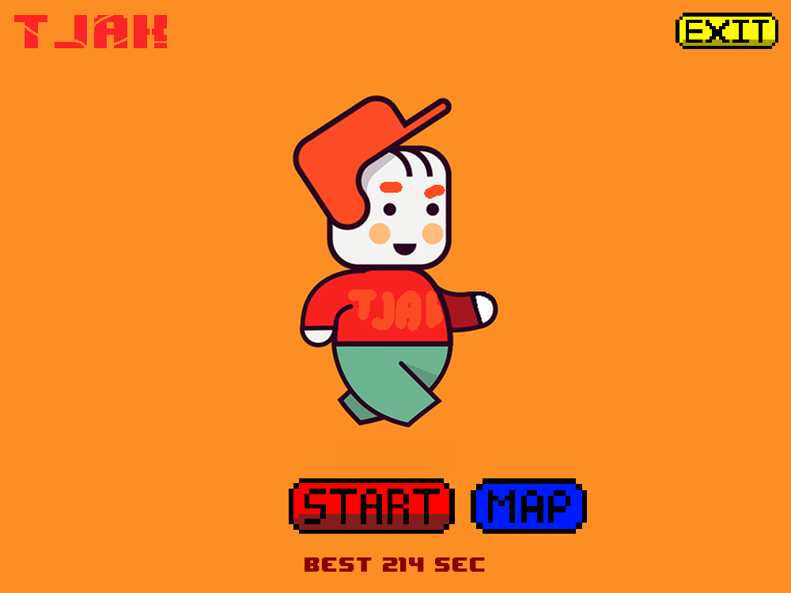
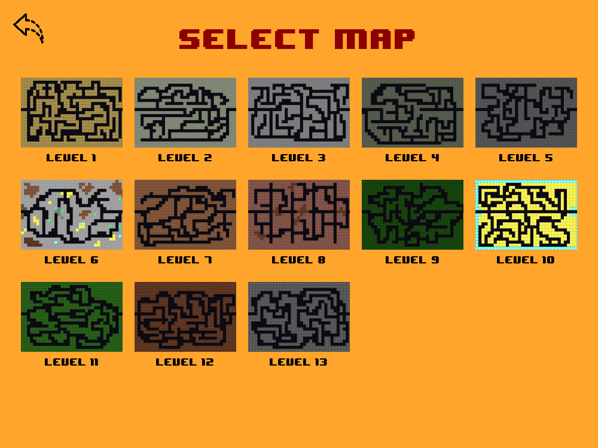
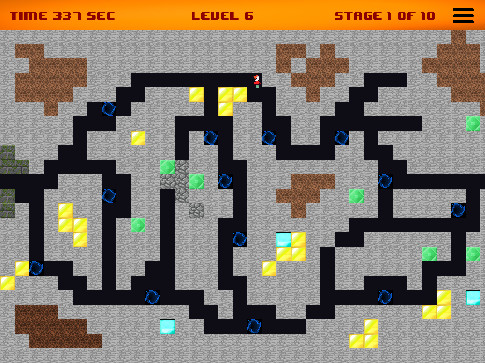
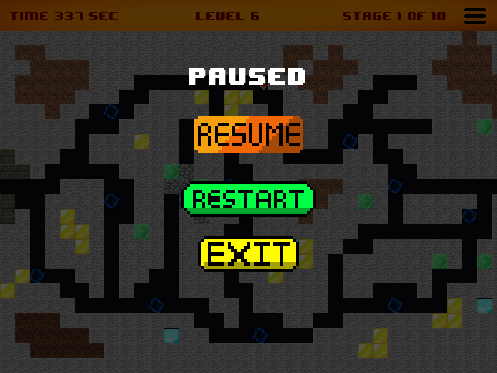
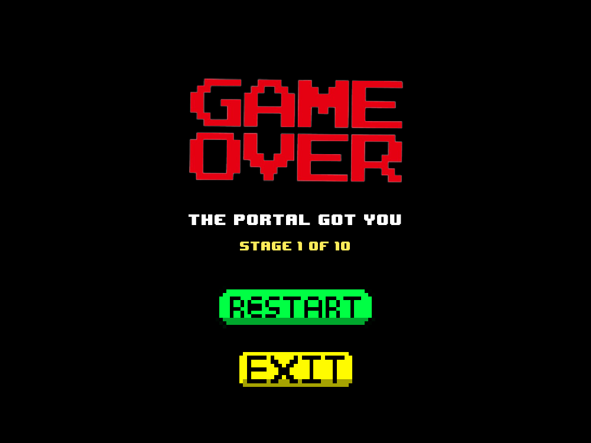
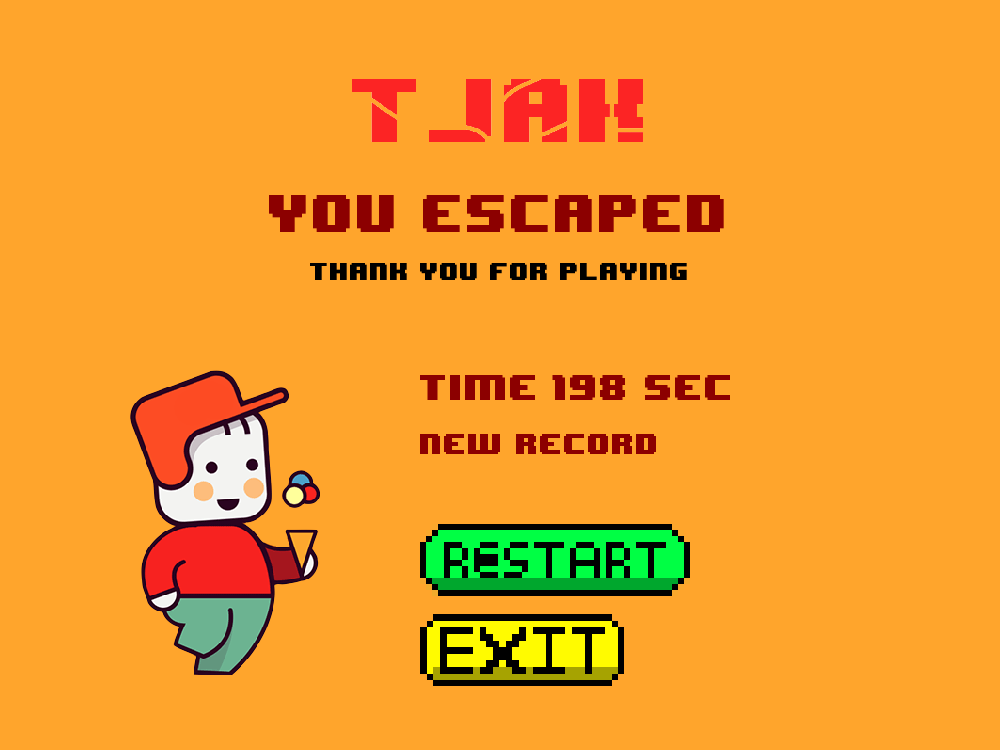

<div align="center">

# 🏃 Escape Game

**เกมวิ่งหนีออกจากเขาวงกต 2D สไตล์ 8-bit สร้างด้วย Python และ Pygame**

ผ่านให้ครบ 10 ด่านก่อนเวลาหมด และอย่าเดินชนวงแหวนมิติ!

[](https://github.com/madara1150/Project/actions/workflows/tests.yml)




</div>

## ✨ ฟีเจอร์

- 🗺️ **เขาวงกต 13 แบบ** แต่ละแผนที่มีธีมของตัวเอง และวงแหวนมิติจะเพิ่มขึ้นตามด่าน
- ⏱️ **แข่งกับเวลา** มี 350 วินาทีสำหรับทั้งรอบ เวลาใกล้หมดตัวเลขจะกะพริบเตือน
- 🌀 **วงแหวนมิติหมุนได้** แตะเมื่อไรจบเกมทันที
- 🎯 **เลือกด่านเริ่มต้นได้** จากหน้า Map หรือกด Start เพื่อสุ่มด่าน
- ⏸️ **หยุดเกมได้** มีปุ่ม Resume, Restart, Exit และหยุดอัตโนมัติเมื่อสลับไปหน้าต่างอื่น
- 🏆 **บันทึกสถิติเวลาดีที่สุด** เก็บไว้ในเครื่องและแสดงที่หน้าเมนู
- 🛠️ **World Editor** สำหรับวาดด่านเองในตัว

## 🖼️ ภาพจากเกม

<table>
  <tr>
    <td align="center"><br><b>หน้าเมนู</b></td>
    <td align="center"><br><b>เลือกด่าน</b></td>
  </tr>
  <tr>
    <td align="center"><br><b>ระหว่างเล่น</b></td>
    <td align="center"><br><b>หยุดเกม</b></td>
  </tr>
  <tr>
    <td align="center"><br><b>Game Over</b></td>
    <td align="center"><br><b>ผ่านเกม</b></td>
  </tr>
</table>

## 🚀 เริ่มเล่น

ต้องใช้ Python 3.9 ขึ้นไป

```bash
git clone https://github.com/madara1150/Project.git
```

```bash
cd Project
```

```bash
python3 -m venv .venv
```

```bash
source .venv/bin/activate
```

```bash
pip install -r requirements.txt
```

```bash
python main.py
```

> บน Windows ใช้ `.venv\Scripts\activate` แทนคำสั่ง `source`

## 🎮 วิธีเล่น

เดินจากฝั่งซ้ายออกไปทางขอบขวาของจอให้ได้ 10 ด่านติดกัน เวลาเดินต่อเนื่องทั้งรอบ ไม่รีเซ็ตเมื่อขึ้นด่านใหม่

| ปุ่ม | การทำงาน |
| --- | --- |
| `W` `A` `S` `D` หรือปุ่มลูกศร | เดิน |
| `Esc` | หยุดเกม / เล่นต่อ |
| `M` | เปิด/ปิดเสียง |
| `Enter` หรือ `Space` | เริ่มเกมจากหน้าเมนู / เริ่มใหม่จากหน้า Game Over |

## 🧱 โครงสร้างโปรเจกต์

```text
Project/
├── main.py                 จุดเริ่มต้นของเกม
├── escape_game/
│   ├── app.py              หน้าต่างเกมและ main loop
│   ├── scenes.py           ทุกหน้าจอ: เมนู เลือกด่าน เกม หยุด จบเกม เครดิต
│   ├── player.py           การเดิน การชน และแอนิเมชันตัวละคร
│   ├── level.py            อ่านไฟล์ด่านและสร้างกำแพง/วงแหวน
│   ├── assets.py           โหลดรูป ฟอนต์ และเสียง
│   ├── storage.py          บันทึกเวลาดีที่สุด
│   ├── ui.py               ปุ่มและการวาดข้อความ
│   └── settings.py         ค่าคงที่ของเกม ปรับความยากได้ที่นี่
├── levels/                 ข้อมูลด่านแบบ CSV
├── picture/  sound/        รูปและเสียงในเกม
├── tests/                  ชุดทดสอบ
└── tools/
    ├── world_editor.py     โปรแกรมวาดด่าน
    ├── maze_generator.py   สร้างเขาวงกตแบบ Randomized Prim
    ├── solver.py           หาเส้นทางผ่านด่านอัตโนมัติ
    └── capture_screenshots.py  สร้างรูปใน README ใหม่จากเกมจริง
```

## 🗺️ สร้างด่านเอง

```bash
python tools/world_editor.py
```

| การควบคุม | การทำงาน |
| --- | --- |
| คลิกซ้าย / คลิกขวา | วาง / ลบ tile |
| `↑` `↓` | เปลี่ยนเลขด่าน |
| `←` `→` (กด `Shift` ขวาเพื่อเร่ง) | เลื่อนแผนที่ |
| ปุ่ม Save / Load | บันทึกหรือโหลดไฟล์ใน `levels/` |

Tile เลข 0–19 คือกำแพง ส่วนเลข 20 คือวงแหวนมิติ ผู้เล่นเกิดที่แถว 12 ฝั่งซ้าย และ 2 แถวบนสุดจะถูกแถบสถานะบังไว้ หลังแก้ด่านแล้วให้รันเทสต์เพื่อยืนยันว่ายังเดินผ่านได้

## 🧪 สำหรับนักพัฒนา

```bash
pip install -r requirements-dev.txt
```

```bash
pytest
```

เทสต์ทำงานได้โดยไม่ต้องเปิดหน้าต่าง และมีบอทเดินผ่านเกมจริงผ่าน keyboard event เพื่อตรวจว่าทุกด่านผ่านได้ รวมถึงการจบเกม หยุดเกม และบันทึกสถิติ

สร้างรูปใน README ใหม่ได้ด้วย:

```bash
python -m tools.capture_screenshots
```

## 👥 ผู้พัฒนา

ทีม **TJAK**

- Tanatip Singhanon
- Akhabhop Khunkitti
- Ken Muraki
- Jeerachaya Chareonphol

## 🎵 เครดิตเพลง

- *Pixelland* โดย Kevin MacLeod (เพลงหน้าเมนู)
- *Happy 8bit Loop 01* โดย Tristan Lohengrin (เพลงระหว่างเล่น)
